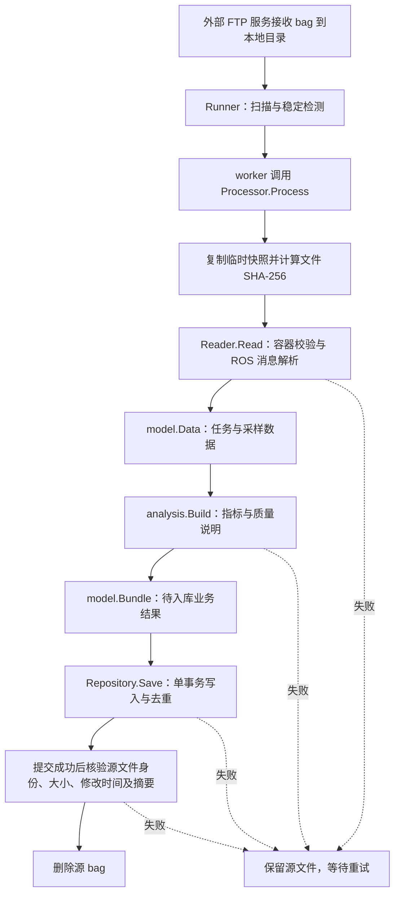

# 项目目录与架构说明

本文根据当前源码整理，描述现有结构及扩展入口，不涉及源码目录搬迁。

## 1. 项目定位

这是一个 **AGV 任务 ROS1 bag 离线解析与健康指标入库服务**，使用 Go、GORM 和 MySQL。它扫描 FTP 服务已经接收到本地的文件，解析任务和采样数据，计算指标，通过事务写入业务表，确认提交后删除源文件。

当前程序通过命令行运行，没有 HTTP API、路由、Controller 或前端，也不负责启动 FTP 服务。配置、日志和数据库初始化复用公司私有模块 `server01.jz/cloudia-module/mcs`。

## 2. 当前目录树

```text
health-bag-server/
├── main.go                         # 程序入口：命令行、初始化、依赖组装、退出处理
├── health_server.yml               # 日常配置：MySQL 和车辆接收目录等
├── go.mod                          # Go 模块及依赖版本
├── go.sum                          # 依赖校验信息
├── .gitignore                      # 构建产物、运行数据、本地配置等忽略规则
├── README.md                       # 使用、部署、配置及指标口径说明
├── docs/
│   └── architecture.md             # 本文：目录职责与架构导航
├── internal/                       # 仅供本项目内部使用的 Go 包
│   ├── config/                     # 配置层
│   │   └── config.go               # 配置类型、默认值、加载、路径解析与参数校验
│   ├── bag/                        # ROS1 bag 解析层
│   │   ├── validate.go             # 容器记录边界、索引位置、块大小等校验
│   │   ├── decoder.go              # 按 bag 内嵌 ROS 定义递归解码二进制消息
│   │   └── reader.go               # 读取 bag、分派话题、解析业务字段及事件去重
│   ├── model/                      # 共享数据结构
│   │   ├── data.go                 # 话题常量、采样类型、Data、Bundle、任务键与摘要
│   │   └── tables.go               # 六张业务表的 GORM 模型、公共统计及事件结构
│   ├── analysis/                   # 业务分析层
│   │   ├── analysis.go             # 分析总入口、过程控制、伺服误差、质量说明与摘要
│   │   ├── twisting.go             # 角速度重采样、FFT 频谱特征、可选扭动事件判定
│   │   └── tracking.go             # 执行器字段映射、指令反馈配对、误差和响应时间
│   ├── database/                   # 数据持久化层
│   │   └── repository.go           # 自动建表、事务写入、任务去重与内容冲突检测
│   └── ingest/                     # 文件导入调度与流程编排
│       ├── runner.go               # 递归扫描、稳定检测、worker 队列、重试调度
│       └── processor.go            # 临时快照、解析分析入库编排、提交后核验删除、日志
├── bin/                            # 已有构建产物，不属于源码
│   ├── health-bag-server.exe        # Windows 可执行文件
│   └── linux-amd64/
│       └── health-bag-server        # Linux amd64 可执行文件
└── data/                           # 运行数据目录，当前目录下未发现文件
```

`data/work/` 是配置默认的临时快照目录，由程序处理文件时创建，不是当前已有源码目录，也不是归档目录。`logs/` 和 `health_server.local.yml` 出现在忽略规则中，并不代表当前已经存在。

## 3. 各模块如何协作

### 启动与组装

`main.go` 的 `run()` 负责加载配置、处理命令行分支、初始化 MCS 日志与 MySQL、创建 Repository、Reader、Processor 和 Runner，并监听 Ctrl+C / SIGTERM。

四种运行方式：

- `-check-config`：加载并校验配置，不连接 MySQL。
- `-check-bag`：执行 `Reader.Read → analysis.Build → JSON 输出`，不连接 MySQL、不删除 bag。
- `-migrate-only`：初始化数据库业务表后退出。
- 无以上参数：启动常驻扫描处理；默认启动时自动迁移业务表。

### 文件处理主链路



临时快照在处理函数结束时通过 `defer` 尝试删除。扫描、快照复制等阶段失败也会保留源文件并等待重试。文件连续稳定默认等待 60 秒，默认每 5 秒扫描、失败间隔 60 秒重试、1 个 worker；这些默认值位于 `config.Defaults()`。

### 代码依赖与接口边界

以下箭头表示项目内部包的直接导入关系，与上面的业务执行顺序不同：

```text
main      → config、bag、analysis、database、ingest
ingest    → config、analysis、model
bag       → model
analysis  → config、model
database  → model
config    → MCS（无项目内部包依赖）
model     → Go 标准库（无项目内部包依赖）
```

`ingest` 不直接导入 `bag` 或 `database`，而是在 `processor.go` 定义 `BagReader` 和 `Saver` 接口，由 `main.go` 注入具体实现。`runner.go` 通过 `Handler` 接口调用单文件处理器。这样可分别替换读取、存储或单文件处理实现。

`model.Data` 是读取后的内存数据集合，`model.Bundle` 是分析后的业务结果集合。当前采样结构与数据库模型共用 `model` 包，到点和伺服数据也直接复用了表模型，并非完全隔离的领域模型与持久化模型。

## 4. 数据输入与输出

当前支持七个话题，话题常量集中在 `model/data.go`：

- `/nav_manager/mission_info`：任务摘要，确定车辆上下文以外的任务身份和时间范围。
- `/nav_manager/nav_reach_precision`：到点数据，保存三类 x/y/yaw 原值。
- `/nav_manager/process_control_error`：过程控制误差与定位跳动累计计数。
- `/emma_odom`：里程计，提供角速度频谱分析输入。
- `/mux_vel`：执行器指令。
- `/jz_cmd_feedback`：执行器反馈。
- `/ibvs_constrained_action/result`：伺服执行结果及原始位姿。

六张 MySQL 表由 `model/tables.go` 定义，通过 `Repository.Migrate()` 初始化：

- `health_task`：任务主表，含唯一任务键、业务摘要、分析版本与质量说明。
- `health_reach_precision`：每个到点事件一条记录，通过 `task_id` 关联任务。
- `health_process_control`：每任务一条过程控制汇总，`task_id` 为主键。
- `health_twisting`：每任务一条扭动分析汇总，`task_id` 为主键。
- `health_actuator_tracking`：每任务、每配置通道一条跟踪统计记录。
- `health_servo_result`：每个伺服结果事件一条记录，通过 `task_id` 关联任务。

这里的关联描述的是业务及字段关系，不表示代码已经声明数据库外键约束。没有独立的文件导入历史表。

## 5. 理解项目时需要抓住的规则

1. **一个 bag 对应一个任务。** 必须存在有效任务摘要，不能通过文件名猜测；多个不同任务摘要会拒绝处理。
2. **文件稳定不等于文件完整。** 稳定检测只决定何时尝试；容器、索引和消息校验决定是否接受。
3. **提交成功才进入删除阶段。** 删除前还要核对源文件是否仍与快照一致；删除失败后可在下次去重后继续清理。
4. **文件摘要和业务摘要用途不同。** 文件 SHA-256 用于快照一致性与删除核验；`Task.DataDigest` 用于拒绝同任务不同业务结果的覆盖。
5. **未知值具有业务含义。** 缺少期望伺服位姿时不计算伺服误差；没有标定扭动阈值时只输出频谱特征；存在执行器话题但未配置映射时整个 bag 保留并重试。
6. **数据会进入内存后再分析。** Reader 返回采样集合，不是逐条消息直接入库；扩大文件大小、消息数量或 worker 数时要考虑内存占用。
7. **源 bag 删除后无法完整重算。** 数据库保留业务结果及部分事件原值，不保留全部原始高频采样。

## 6. 后续修改入口

- 调整 MySQL、接收目录或车辆 ID：先看 `health_server.yml`。
- 调整默认扫描、稳定等待、重试、并发或限制：看 `internal/config/config.go`。
- 调整文件扫描和队列行为：看 `internal/ingest/runner.go`。
- 调整快照、提交后删除或处理日志：看 `internal/ingest/processor.go`。
- 增加话题：同步考虑 `model/data.go`、`bag/reader.go`、分析入口与输出模型；目前未知话题会直接拒绝处理。
- 兼容 ROS 字段或类型：看 `bag/reader.go` 与 `bag/decoder.go`。
- 调整控制误差、质量说明或伺服误差：看 `analysis/analysis.go`。
- 调整频谱和扭动算法：看 `analysis/twisting.go`。
- 调整指令反馈配对和响应时间算法：看 `analysis/tracking.go`。
- 新增业务字段或表：同步修改 `model/tables.go`、分析构建逻辑与 `database/repository.go`。
- 调整事务、去重、冲突策略：看 `database/repository.go`。

建议阅读顺序：`main.go → ingest/runner.go → ingest/processor.go → model/data.go → bag/reader.go → analysis/analysis.go → model/tables.go → database/repository.go`，再深入解码器与具体算法。

## 7. 目录维护建议

现有六个内部包的职责比较清晰，当前规模下可以继续沿用。本文只新增文档，不移动源码或改变包路径。

若后续持续增长，可以按实际需求再拆分：

- `analysis.go` 中的过程控制和伺服计算分别移到同包的 `process_control.go`、`servo.go`，保持 `Build` 作为组合入口。
- `processor.go` 中的快照和删除核验移到同包的独立文件，缩短流程编排代码。
- 有多程序入口时再引入 `cmd/health-bag-server/main.go`；当前根目录入口足够直接。
- 后续增加查询 API 时再增加对应传输层，保留现有导入处理链路。

当前未发现 `*_test.go`、Dockerfile 或 CI 配置，目录也没有 Git 仓库元数据。以上是本次工作目录的实际情况，不代表其他交付环境没有这些内容。私有 MCS 模块需要对应访问权限或本地模块缓存。本文依据源码静态梳理，未执行数据库迁移或真实 bag 导入。
