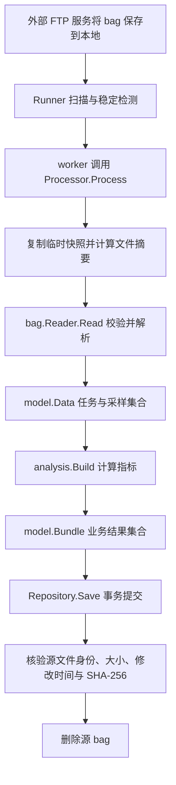

# 项目目录与架构说明

项目是 Go + MySQL 的 AGV 任务 bag 离线处理服务：扫描外部 FTP 服务接收的本地文件，解析 ROS1 消息，分析健康指标，事务入库后核验并删除源 bag。当前不提供 HTTP API，也不负责 FTP 接收。

## 目录结构

```text
health-bag-server/
├── main.go                       # 展示完整启动顺序与退出处理
├── health_server.yml             # MySQL、车辆接收目录和可选分析配置
├── go.mod / go.sum               # 模块依赖及校验信息
├── README.md                     # 构建、运行和业务口径
├── config/                       # 配置管理
│   └── config.go                 # 配置类型、默认值、加载、路径解析与校验
├── model/                        # 共享数据与业务表模型
│   ├── data.go                   # 话题常量、任务、采样 Data、结果 Bundle、摘要
│   └── tables.go                 # 六张 GORM 业务表及公共结构
├── service/                      # bag 处理业务
│   ├── bag/
│   │   ├── validate.go           # 容器记录、索引、块大小校验
│   │   ├── decoder.go            # 按内嵌 ROS 定义解码二进制消息
│   │   └── reader.go             # 读取、话题分派、字段解析与事件去重
│   ├── analysis/
│   │   ├── analysis.go           # 分析总入口、过程控制、伺服误差与质量说明
│   │   ├── twisting.go           # 角速度重采样、FFT、可选扭动事件判定
│   │   └── tracking.go           # 执行器映射、指令反馈配对、误差和响应时间
│   └── ingest/
│       ├── service.go            # 导入服务入口，组装 Reader、Processor、Runner
│       ├── runner.go             # 目录扫描、稳定检测、worker 队列与重试
│       └── processor.go          # 快照、处理编排、提交后核验删除与日志
├── server/                       # 基础设施
│   └── database/
│       ├── connection.go         # 关闭 MCS 数据库连接
│       └── repository.go         # 自动迁移、事务保存、去重与冲突检测
├── docs/
│   └── 项目目录与架构.md           # 本文
├── bin/                          # Windows、Linux 编译产物
└── data/                         # 运行数据；默认临时目录为 data/work
```

不再使用 `internal/app` 包统一隐藏启动流程，也不再把所有代码放入 `internal`。`service/bag` 包含本项目特定话题的解析，因此归入业务服务，而不是抽象成通用工具包。

## main.go 的启动顺序

借鉴 weixinnuo 的组织方式，让基础设施初始化和业务启动在入口中直接可见：

1. 解析可选的 `-config` 参数，通过 `config.Load` 加载和校验配置。
2. `mcs.InitLog("health-bag-server")` 初始化日志。
3. `mcs.InitMysql(cfg.Mysql, false)` 初始化 MySQL，注册连接关闭操作。
4. 建立 Ctrl+C / SIGTERM 取消上下文。
5. 启用 `auto_migrate` 时，通过 `Repository.Migrate` 初始化业务表。该配置默认为 true。
6. `ingest.Start(ctx, cfg, repository)` 启动导入业务，阻塞等待退出。
7. 退出时先停止导入、等待 worker，再关闭数据库连接。

`main()` 负责错误输出和非零退出码。`run()` 按顺序启动服务，并将异常转换为错误。worker 组装和数据库连接清理分别由 ingest 和 database 负责。

## 数据处理链路



处理失败保留源文件并等待重试。临时快照在处理结束时尝试清理，不作为归档。默认每 5 秒扫描，连续稳定 60 秒后处理，失败间隔 60 秒重试，使用 1 个 worker。默认值集中在 `config/config.go`。

## 模块依赖与接口

- `main` 负责组装，依赖 config、database 和 ingest。
- `ingest.Start` 创建具体 Reader，再将其与传入的 Saver 注入 Processor。
- `Runner` 通过 `Handler` 接口调用单文件处理。
- `Processor` 通过 `BagReader` 和 `Saver` 接口读取和保存，调用 `analysis.Build`。
- `bag` 依赖 model；`analysis` 依赖 config 和 model；database 使用 model 定义的表。
- model 只依赖 Go 标准库，不管理日志、连接或服务启动。

`Data` 是读取后的内存采样集合，`Bundle` 是分析后的待入库结果。当前采样结构与数据库模型共用 model 包，到点和伺服数据直接复用表模型。一次任务会先读取到内存再分析，扩大文件限制或并发数时应评估内存使用。

## 数据与业务规则

话题常量定义在 `model/data.go`，支持任务摘要、到点数据、过程控制误差、里程计、执行器指令、执行器反馈、伺服结果七类话题。未知话题只参与容器完整性校验，跳过消息解码、业务统计和分析。bag 仍须包含有效任务摘要。

六张表定义在 `model/tables.go`：

- `health_task`：任务主表，含唯一任务键、业务摘要、分析版本和质量说明。
- `health_reach_precision`：每个到点事件一条记录。
- `health_process_control`：每任务一条过程控制汇总。
- `health_twisting`：每任务一条扭动分析汇总。
- `health_actuator_tracking`：每任务、每配置通道一条记录。
- `health_servo_result`：每个伺服事件一条记录。

子表通过 `task_id` 关联任务，这是业务字段关系，不表示代码已声明数据库外键约束。

关键规则：一个 bag 必须对应一个有效任务；文件稳定后仍要校验完整性；只有明确提交成功且源文件核验一致，才允许删除。文件 SHA-256 用于快照一致性和删除核验，业务 DataDigest 用于拒绝同任务不同结果的覆盖。相同任务、相同业务结果重试不会重复插入。

未配置期望伺服位姿时不计算伺服误差，未标定扭动阈值时只输出频谱特征；存在执行器话题但未配置字段映射时保留整个 bag 并重试。源 bag 删除后，数据库结果不能恢复全部原始高频采样。

## 修改入口

- 调整配置路径参数、启动顺序、日志和 MySQL 初始化：`main.go`。
- 调整配置默认值与校验：`config/config.go`。
- 调整文件扫描、worker、重试：`service/ingest/runner.go`。
- 调整快照、提交后删除、处理日志：`service/ingest/processor.go`。
- 增加话题或兼容消息：`model/data.go`、`service/bag/reader.go`、`decoder.go`。
- 调整指标：`service/analysis/`。
- 调整表字段：`model/tables.go`，同步修改分析构建和事务保存。
- 调整迁移、事务与去重：`server/database/repository.go`。

已执行构建、包检查和命令行冒烟检查。当前没有测试文件；未执行真实 MySQL 迁移、入库或真实 bag 导入。构建依赖公司私有 MCS 模块的访问权限或模块缓存。
